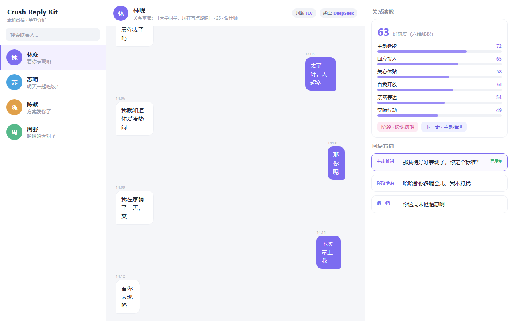

# Crush Reply Kit

读本机微信聊天记录，判断关系，给出几个可以发出去的回复方向。本地服务，浏览器打开即用。

它不负责让你脱单，只负责在你盯着输入框删了打、打了删的时候，递过来几个句子。




分析结果来自模型对文字的判读，读不到聊天之外的现实，对方回得慢可能只是忙。只当参考。

## 能做什么

连上本机微信，左栏列出所有联系人。选一个人，填对方是谁：年龄、身份，以及你们现在什么关系。关系那栏写一句话，比如「同事，不暧昧」，它按这句话当打分基准，也用它推出关系档位。

跑完一次给三样东西：

1. 关系读数。好感度（六维加权出来的分数，点开看细项）、阶段、下一步该主动还是该等，以及它权衡过的另一个动作。
2. 逐句读数。对方每句话的情绪和意图分布，你自己每句话的表达质量评分。对话流默认停在最新一句，往上滑看更早的。
3. 几个回复方向，每个方向一句。默认三个：判定的动作、它权衡过的另一条路、按规则退一档的方向。选中一条进剪贴板。

回复方向有几条硬规矩：

- 判定为「等」或「尊重边界」时不写句子，这时候正确的做法就是先别发。
- 判定没把握时拿「顺着聊」当基准，照样给三个能发的方向。
- 明确划了边界、且判断清晰时只给一条「尊重边界」，不给菜单。
- 写句子只走线上：一到两句、40 字以内，不提见面吃饭看电影，不解释为什么这么回。
- 好感度、氛围、对方最近几句的情绪和意图会一起喂给写句子的模型，让它不只靠猜语气。
- 历史超出窗口的部分先压成摘要再给模型，不是从头截断。

跟对方又聊过之后点更新，只分析游标之后的新消息，算过的不重算。每个人单独存一份设定、游标和更早历史的摘要，换个人互不影响。

## 架构

三段：IN 取数据，THINK 判断，OUT 起草。`server/pipeline.ts` 是唯一知道三段都存在的模块，每段都藏在接口后面可以替换。

### IN 取数据

`shared/sources.ts` 定义 `SourceAdapter`，产出 `NormalizedSession`（稳定 peerId、显示名、Message 数组）。Message 用的就是 crush-monitor 的形状，换数据源不需要动下游。

三个实现：

| 实现 | 读什么 |
| --- | --- |
| wechat | 解密后的本地库，`shared/wechat-db.ts` |
| manual | 一个 JSON 文件，开发和测试用 |
| inline | 前端直接把消息传进来 |

解密不在本项目里做。`server/wechat-sync.ts` 调外部工具 wcdb-key-tool，密钥每次从微信进程内存取，所以微信要开着并登录着。工具来源见「外部依赖」一节。

读微信必须指定分析对象，白名单为空一律拒绝。

### THINK 判断

沿用 crush-monitor 的 `analyze()`。两类任务：

1. `overviewJob` 出整段的关系读数。好感度是六维加权（主动延续、回应投入、关心体贴、自我开放、亲密表达、实际行动），外加阶段、下一步动作，以及它权衡过的另一个动作。
2. `incrementalJobs` 出逐句读数。对方每句的情绪和意图分布，自己每句的表达质量评分。

逐句判定有窗口，上限 60 条；前端不传时跟展示窗口对齐。

判定骨架在 `shared/` 下（`types.ts`、`rules.ts`、`affinity.ts`、`action.ts`、`intents.ts`、`labels.ts`、`memory.ts`、`ratings.ts`、`incremental.ts` 等），原样沿用 crush-monitor，按 JEV 调过。阈值和权重本项目没动。

### OUT 起草

`server/candidates.ts` 的 `draftCandidates()` 把判读变成几个方向，每个方向一句。

更早的历史超出起草窗口时，`server/summarize.ts` 先压成摘要再给模型，避免从前面被截断。

输出模型独立配置，OpenAI 兼容任意一家。

### 两个模型分开配

|  | 判断模型（THINK） | 输出模型（OUT） |
| --- | --- | --- |
| 接口 | `/api/settings` | `/api/chat-settings` |
| 配置落在 | `.runtime/model.json` | `.runtime/chat.json` |
| 默认 | JEV | DeepSeek |

两个接口就是这两份配置的读写口子，网页右上角选好模型、填完 Key 提交即可，立刻生效，不用重启。

判断侧默认 JEV，因为判定骨架是按它的输出分布校的。换别的判断模型能跑，分数和动作的可靠性会降。输出侧只负责把判读翻成句子，没有调过任何东西，随便换。

### 多人，每人一份存档

`/api/peers` 列出库里的联系人。每个联系人一个文件 `.runtime/peers/<peerId>.json`，存两件事：上次读到哪条消息（游标），以及对方是谁（年龄、身份、关系原话）。更早历史的摘要单独存 `<peerId>.summary.json`，清游标不会连带丢掉摘要。

`/api/pipeline` 有 baseline 和 update 两种模式。第一次跑 baseline 读全量，之后 update 只拉游标之后的新消息，跑完推进游标。一次请求分析一个人。

### 前端

`src/Workspace.tsx` 单页面，三栏：左栏联系人，中间对话流（默认停在最新一句，往上滑看更早），右栏判读和回复方向。

选中的方向写到剪贴板。

## 与 crush-monitor 的关系

基于 [crush-monitor](https://github.com/FerryCorleone/crush-monitor)（MIT）开发，在它的判定骨架上长出来，按开源社区的叫法是它的衍生作品。原项目 README 有一节「社区作品」专门收录这类二次开发的版本。

沿用的部分：crush-monitor 的判定骨架（好感度六维、阶段、动作那套判定逻辑）、模型协议栈，以及前端模型设置弹窗。判定骨架按 JEV 的输出分布校过，本项目没动阈值和权重。

新增的部分：IN 段的微信数据源与解密接线、双模型里的 OUT 起草与候选生成、每人一份的多人存档，以及整个前端界面。

改动过的一处：`server/analysis.ts` 里关系基准用填写的原话，不再套枚举预设。

## 外部依赖

解密和判定都来自外部项目，三个都是 MIT。

| 项目 | 用在哪 | 来源 |
| --- | --- | --- |
| crush-monitor | 判定骨架、模型协议栈 | [FerryCorleone/crush-monitor](https://github.com/FerryCorleone/crush-monitor) |
| wcdb-key-tool | 从微信 4.1+ 进程内存取密钥 | [TANGandXUE/wcdb-key-tool](https://github.com/TANGandXUE/wcdb-key-tool)，版权 CloudDreamAI / TANGandXUE |
| wechat-4x-decrypt | 解密与检索的封装，wcdb-key-tool 在它里面 | [xscanzm/wechat-4x-decrypt](https://github.com/xscanzm/wechat-4x-decrypt)，MIT，版权周一（皮皮未来 / Pipi Future） |

微信 4.1 起进程内存里不再有明文密钥，靠扫 `x'hex'` 的老工具全部失效，所以只能用 wcdb-key-tool 这套。它只做解密，不参与判断。

工具目录和 Python 解释器路径写在 `server/wechat-sync.ts` 顶部，换机器要改，也能用环境变量 `WECHAT_TOOL_DIR` 和 `WECHAT_PYTHON` 覆盖。

## 目录

```
server/
  index.ts              路由与启动
  pipeline.ts           IN → THINK → OUT 编排
  pipeline-api.ts       /api/pipeline，baseline/update 与游标
  candidates.ts         判读翻成几个方向
  summarize.ts          更早历史压成摘要
  wechat-sync.ts        调外部工具解密
  peers-api.ts          /api/peers，联系人列表与设定
  peer-state.ts         每人一份游标、设定、摘要
  chat-client.ts        聊天补全
  chat-config.ts        输出模型配置
  settings-api.ts       判断模型 /api/settings
  chat-settings-api.ts  输出模型 /api/chat-settings
  analysis.ts           拆题与评分维度（沿用，关系基准有改动）
  provider.ts llm.ts model-config.ts liquid.ts openai-decisions.ts  协议栈（沿用）
shared/
  sources.ts            IN 的接口与三个实现
  wechat-db.ts          读解密后的库
  pipeline-types.ts     报告与设定类型
  chat-presets.ts       输出模型预设
  types.ts rules.ts affinity.ts action.ts intents.ts labels.ts      判定骨架（沿用）
  memory.ts ratings.ts incremental.ts parser.ts model-presets.ts    判定骨架（沿用）
src/
  Workspace.tsx         唯一页面
  ModelSettings.tsx     模型配置弹窗（沿用）
scripts/
  start.ts              只起服务端
  inspect-wechat-db.ts  探库结构
tools/
  stub-decision-server.ts  测试的替身判断服务，说的是 System One 协议
tests/
```

## 运行

```bash
git clone https://github.com/JerryJiang930/crush-reply-kit.git
cd crush-reply-kit
npm install
npm run dev
```

`npm run dev` 起接口（3178）和网页（5178，带热更新），起来后自动打开浏览器。只想起服务端用 `npm start`，访问 `http://127.0.0.1:3178`。

| 依赖 | 版本 | 说明 |
| --- | --- | --- |
| Node.js | 22.12 以上 | 用到内建 `node:sqlite` |
| Windows | 10 / 11 | 读微信这条路只在 Windows 上跑过 |
| 微信 PC | 4.1 以上 | 解密要读它的进程内存，必须开着并登录着 |
| Python | 3.13 | 只给解密工具用 |

微信那条路在网页左栏点连接，服务端自己解密，明文快照写到 `.runtime/wechat/decrypted`。首次解密会写 `.runtime/wechat/owner.json`，记你的 wxid 和库路径，换账号或换机器要改。

## 已知限制

- 只处理文本。图片、语音、表情在库里有记录但没有可读内容，跳过。
- 电脑端的库只记录这台机器上收发过的。手机上看过没同步的、对方撤回的、你删掉的都不在里面，对话可能不连续。
- 判定是概率输出，不是对现实的测量。
- 两个模型的 Key 明文存在 `.runtime` 下，别分享，别提交到仓库。

## 许可证

MIT。判定骨架和解密工具都来自外部 MIT 项目，各自的版权声明随本项目保留，见「外部依赖」一节。本项目与微信、腾讯及 TypeSafe 无隶属关系。

有问题开 issue，改完发 PR。
